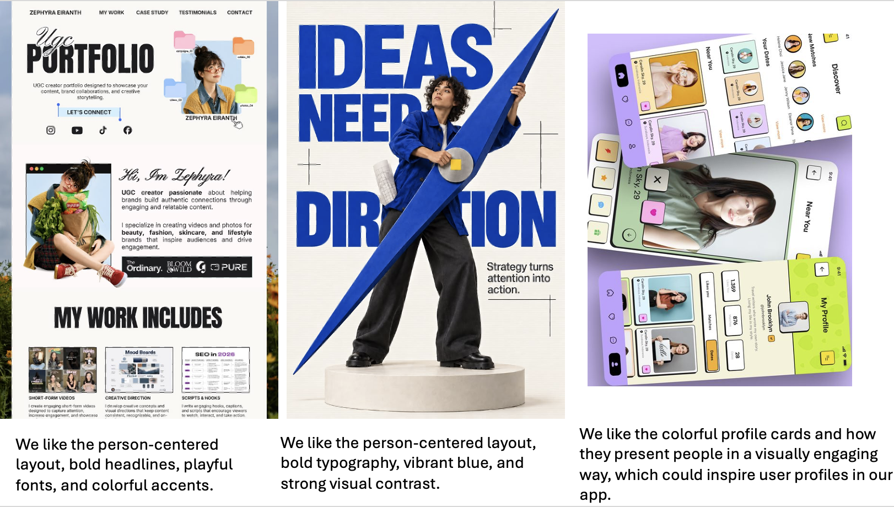
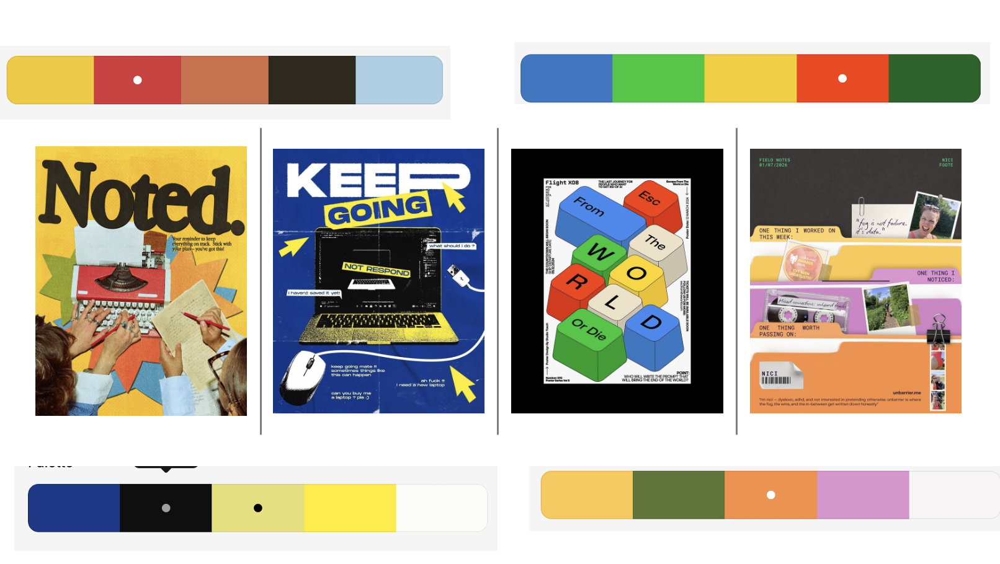

# Design Study

We explored different typography and color options for our app. We want the design to look **professional but also visually interesting**. Since our app is about connecting people who might end up building a startup together, we want it to feel trustworthy and serious, but not boring. We also want profiles and startup pitches to be easy to read and engaging enough that users would want to explore them.

# Design Decisions

As a group, we discussed several design decisions about how our app should work and how to divide it into concepts.

**ProfileSetting vs. PreferenceChoosing**

One of our first discussions was whether choosing preferences should be a separate concept from ProfileSetting. We initially kept them together because users enter both during setup. In the updated design, ProfileSetting holds the information people share about themselves, while Recommending holds the preferences used to rank other people. Users can still enter both during the same setup process. This keeps preferences with the behavior that uses them without adding a separate PreferenceChoosing concept.

**Founder vs. Builder**

We also discussed whether users should be able to register as both founders and people looking to join a startup. We decided that users should choose only one role: either a founder looking for teammates or someone looking to join a startup as an employee or co-founder. This makes the matching process simpler because founders would be recommended builders and builders would be recommended founders.

**Tinder-like vs. Hinge-like Matching**

Another important discussion was what type of matching system we wanted. We considered two options. The first was a Tinder-like system where both users independently swipe on each other, and a match only happens if both express interest. The second was a Hinge-like system where, if someone expresses interest in another person, that person gets notified and can decide whether they want to match.

We decided to go with the **Hinge-like approach** because we feel that knowing someone is already interested in working with you is important when deciding whether they would be a good match for your startup. We also decided to call the action **Show Interest** instead of swiping right, since it better describes what users are actually doing.

Users will have a separate **Interested in You** section where they can see people who have already expressed interest in them.

**Pass vs. See Later**

We also discussed what should happen when someone doesn't want to show interest in a profile. Instead of only having Pass, we decided to add a **See Later** option. Sometimes someone might find an idea interesting but not be ready to make a decision. If they choose See Later, that person can appear in their recommendations again. If they choose Pass, the profile will not be recommended again.

**How Recommendations Should Work**

We decided that recommendations should consider shared interests, complementary skills, availability, university preferences, and physical proximity. We think all of these factors matter when choosing someone to work with.

We also wanted the app to connect students across different universities instead of limiting them to their own school's startup community. In the initial version, the five factors have equal weight. The concept design explains how each factor is calculated, including what happens when someone leaves a preference empty. University preferences come only from what the user selects; no school gets extra points because of its reputation. These preferences affect ranking without excluding people from other schools.

**Matching, Notifications, and Chatting**

We decided that users should only be able to chat after both people express interest and become a match. We separated Notifying and Chatting into their own concepts because they have different purposes. Notifying keeps users updated about new interest, matches, and messages, while Chatting allows matched users to communicate privately.

# Design Summary

Our app consists of five main concepts: **ProfileSetting, Recommending, MutualMatching, Notifying, and Chatting**.

ProfileSetting allows founders and students looking to join startups to create, update, publish, and hide their profiles. Recommending holds their matching preferences and uses the relevant profile information supplied through reactions to show people who are more likely to be compatible, instead of making users go through hundreds of startup listings.

When someone finds a person or startup idea interesting, they can use MutualMatching to express interest. The other person gets notified through Notifying and can decide whether to express interest back. If both people are interested, they become a match, and Chatting allows them to start a conversation.

Together, these concepts address our three bad situations. **Choice overload** is reduced by recommending relevant people instead of displaying hundreds of unrelated listings. **University silos** are addressed by allowing students from MIT, BU, Harvard, Tufts, and other nearby universities to discover each other. **Ideas getting buried** is addressed by prioritizing compatibility rather than simply showing startups in the order they were posted.

We also want to be careful about some ethical concerns. Since users share personal information such as their university, skills, and interests, we want them to have control over what is visible on their profiles. We also don't want the recommendation algorithm to unfairly favor students from certain universities or founders who are better at making visually appealing pitches. Our goal is to recommend people based on how well they might work together, not just how impressive their profiles look.

There are still a few things we need to figure out. We have a starting rule for compatibility scores, but we need to see how well it works for users, how to make sure new users get enough recommendations, and how to measure whether a match is actually successful. We also need to think more about how to prevent fake profiles and unwanted interactions.

Overall, our goal is to make finding startup teammates easier and more personal. Instead of scrolling through startup names or relying on existing connections, users should be able to discover people who share their interests and would genuinely want to work together.
