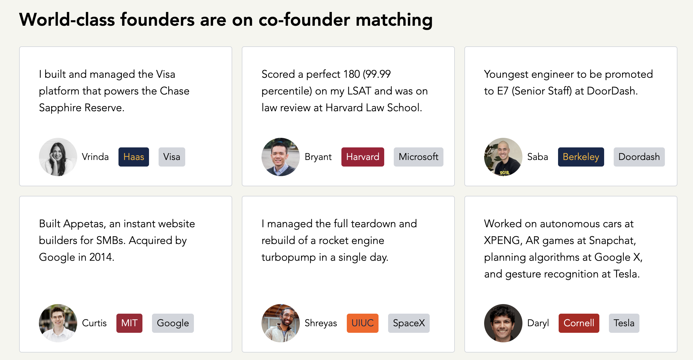

# 4. Workarounds and Comparables

> Workarounds people currently use to mitigate the bad situations, and comparable existing solutions, with an explanation of why each one does not address our bad situations.

## Workarounds

We enumerate several popular existing channels that aspiring builders use to find startup opportunities. Across the board, these products and artifacts fall under one or more of the following "obstacle to use" categories:

- **Barrier to entry:** Huge job search platforms like LinkedIn, Handshake, etc., tend to foster an implicit barrier to entry. UX flows that ask for a list of qualifications and resume attachments during profile setup require preparation and a level of self-advocacy that a user has to spend time tailoring.
- **Formal and high stakes:** Job hiring platforms foster a formal, selective, competitive environment where users operate under an implicit set of bylaws that dictate what is an appealing, successful profile. This can feel emotionally inaccessible and anxiety inducing to those who are just starting. Furthermore, companies and employees use apps such as Handshake with the expectation that user actions taken on the platform are high stakes. Most of these platforms are application portals. When you reach out to a company, it is implicit that you are asking to be hired.
- **Not human-centric:** A number of existing platforms function like an advertisement hub for companies. Companies create profiles or pages for themselves as an organization, and interested users follow those profiles. From the aspiring employee's perspective, this can feel like "talking at a wall." You have no real way to connect with the people behind the companies you are interested in. For large, well-established companies, this is necessary because they don't have capacity to connect with every applicant on a personal level. However, for nascent and aspiring startups, this layer of human connection is invaluable in the early stage, and platforms like LinkedIn are not built to foster these connections.
- **Difficult to access:** More localized options such as email broadcast, campus publicity, and in-person recruiting events are infrequent, difficult to access, and decentralized. Our app aims to streamline that process and deliver it right on the phone screen in a low-stakes, engaging, and stress-free environment.

### Handshake (and other job portals)

**Obstacles:** not human-centric, high stakes

Handshake and platforms like it can feel emotionally inaccessible and anxiety inducing due to their high stakes and lack of connectivity. There is a heavy social asymmetry between companies and employees, and your available set of user actions are procedural and logistical.

### LinkedIn

**Obstacles:** high stakes

While LinkedIn is more human-centric and has a focus on profile sharing, the user experience is modeled in a high-stakes and selective environment. One creates one's LinkedIn profile with the understanding that one will be evaluated, by companies or by peers, based on its content. This can lead to varying levels of unhealthy comparisons between users.

### MIT Orbit & Local Initiatives

**Obstacles:** difficult to access, not human-centric

In our direct vicinity, we have seen several initiatives to help aspiring graduates find a job match. MIT Orbit from the Sloan School, for example, is a platform listing startups. Recently, we also found [this website](https://www.jobsrunway.com). However, these platforms operate similar to Handshake and still function as "advertisement hubs" and "application portals," just geared towards nascent startups. Our app deviates from this approach and focuses on fostering connections between the humans behind the company names.

### Dormspam

**Obstacles:** difficult to access

Every so often, we see startup recruitment emails broadcast over MIT's Dormspam service. Dormspam emails not only fail to reach most of their intended audience, but also get easily lost in students' inboxes. Moreover, they are decentralized, unsystematic, and difficult to recover at a later date. Our app seeks to achieve the dormspam effect via an easy-to-access, ready-on-the-screen platform.

### Public Advertising Events

**Obstacles:** difficult to access, (sometimes) not human-centric

Public advertising events are great as a one-time treat, but they are difficult to access for the organizational effort on the company's part and the extremely low frequency at which they occur. Also, in some cases, public events can feel more like a formality, or sitting through a fancy ad, and this format of publicity fails to foster real connection between interested applicants and the company.

### Word of Mouth

**Obstacles:** difficult to access

Arguably the most effective workaround, and in a formal setting, this might be termed as a "referral." However, referrals don't come easy. They require a ponderous amount of effort spent on browsing for opportunities and networking with the correct individuals, and this process can doubtless be mentally draining. Our matchmaker is designed to abridge precisely this gap, to help our users get a foot in the door by connecting them directly to people whose interests align.

## Comparables

On [this Reddit thread](https://www.reddit.com/r/startups/comments/1d4001h/places_which_help_find_people_to_team_up_with_in/), we found several links to potential comparables. The first link led to a webpage that looked like this:

The six listed profiles showcase some of the highest achieving individuals in their respective fields in a bombardment of company names, titles, achievements, and statistics. In our opinion, it is begging for unneeded comparison, and the elitist messaging conveys that you have to be at least as good as these people to belong on this website. This is the exact situation we'd like to avoid. We want our users to know that not everyone in the world is like these people, that they do not need shiny medals of social approval to be equally bright and talented and passionate, and that everyone had to start somewhere, and we could be theirs. Our users should _see themselves_ as a part of the community we aim to connect together.

## Conclusion

All above accounted, while many channels exist for aspiring workers to find opportunities, we don't believe a human-centric application exists in our immediate community to help bridge the gap between a first-time applicant and the vast, pressurizing, high-stakes environment of real job-search platforms. We hope our matchmaker can act as a stepping stone for talented young adults to come together and inspire each other.
